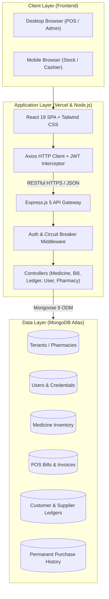
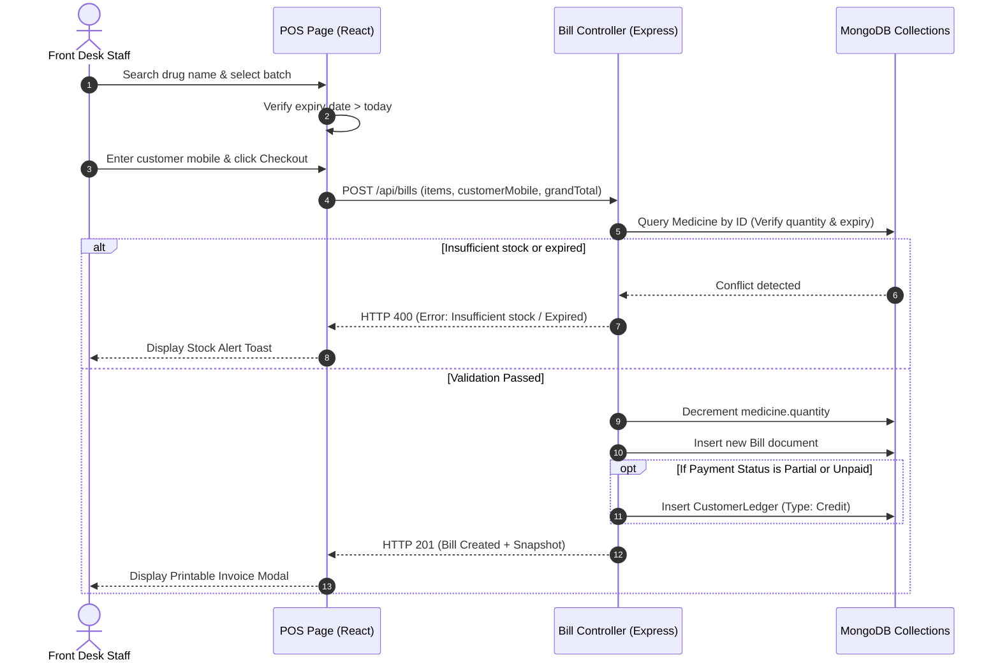
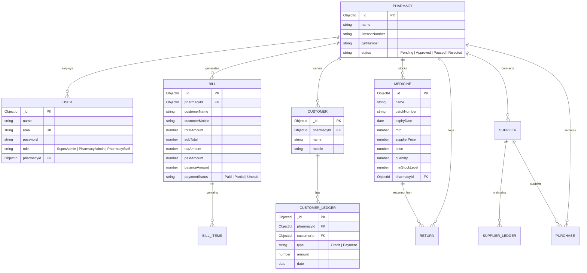

# PROJECT REPORT: MEDICAL STORE MANAGEMENT SYSTEM
## A Multi-Tenant Cloud Pharmacy Operating System & Digital Point-of-Sale Platform

---

**Project Title:** Medical Store Management System (Cloud Pharmacy OS)  
**Author / Developer:** Ishaan Maini  
**Technology Stack:** React 19, Tailwind CSS v4, Node.js, Express.js 5, MongoDB, Mongoose 9, JWT  
**Deployment Target:** Vercel (Frontend) & Cloud Container Infrastructure (Backend)  
**Date of Completion:** November 2026  

---

## TABLE OF CONTENTS
1. [Executive Summary & Abstract](#1-executive-summary--abstract)
2. [Introduction & Background](#2-introduction--background)
   - 2.1 Problem Statement in Traditional Pharmacy Management
   - 2.2 Proposed Solution & Objectives
   - 2.3 Scope of the Project
3. [Literature Survey & Feasibility Analysis](#3-literature-survey--feasibility-analysis)
   - 3.1 Comparison: Traditional vs. Existing vs. Proposed System
   - 3.2 Technical, Operational & Economic Feasibility
4. [Software Requirements Specification (SRS)](#4-software-requirements-specification-srs)
   - 4.1 Functional Requirements by Role
   - 4.2 Non-Functional Requirements
   - 4.3 Hardware & Software Specifications
5. [System Architecture & Design](#5-system-architecture--design)
   - 5.1 High-Level Architecture (Multi-Tenant Client-Server)
   - 5.2 Data Flow Diagram (DFD Level 0 & Level 1)
   - 5.3 Entity-Relationship (ER) Diagram
   - 5.4 Sequence Diagrams
6. [Database Schema & Data Dictionary](#6-database-schema--data-dictionary)
7. [Detailed Module Implementation](#7-detailed-module-implementation)
   - 7.1 Multi-Tenant Authentication & Store Approval Flow
   - 7.2 Intelligent Inventory & Expiry Sentinel
   - 7.3 High-Velocity Digital POS Billing Terminal
   - 7.4 Customer Credit & Ledger ("Udhaar Khata") System
   - 7.5 Supplier Relations & Master Consignment Archival
   - 7.6 Real-Time Circuit Breaker ("Store Paused" Engine)
8. [Testing & Quality Assurance](#8-testing--quality-assurance)
   - 8.1 Test Matrix & Verification Scenarios
   - 8.2 Production Bug Resolution Case Study (MRP vs. Price Synchronization)
9. [Deployment Architecture](#9-deployment-architecture)
10. [Future Enhancements & Roadmap](#10-future-enhancements--roadmap)
11. [Conclusion](#11-conclusion)
12. [References & Appendices](#12-references--appendices)

---

## 1. Executive Summary & Abstract

The **Medical Store Management System**, designed and engineered by **Ishaan Maini**, is a modern, enterprise-grade, multi-tenant cloud application engineered to resolve the operational bottlenecks of retail pharmacies, hospital dispensaries, and chain medical stores.

Traditional pharmacy workflows rely heavily on fragmented paper registers, fragile local desktop databases, or uncoordinated point solutions. These traditional approaches frequently suffer from severe financial leakage caused by untracked batch expirations, slow checkout processing during peak hours, pricing discrepancies between printed MRP and actual selling rates, untracked customer store credit (*"Udhaar"*), and convoluted supplier purchase records.

This project delivers a unified, cloud-native Software-as-a-Service (SaaS) architecture built on **React 19, Tailwind CSS v4, Node.js, Express.js 5, and MongoDB**. The platform incorporates:
- **Automated Expiry Warning Sentinel:** Visual thresholds (Amber at 60 days, Red at 15 days) and hard-stop blocks preventing cashiers from dispensing expired medication.
- **High-Velocity POS Terminal:** Live multi-attribute drug searches with real-time stock deduction, dynamic GST calculations, and printable audit receipts.
- **Customer Ledger ("Udhaar Khata"):** Automatic ledger entries for credit purchases, customer profile management, and running balance calculation.
- **Supplier Invoicing & Purchase Archival:** Complete batch intake with Master Invoice tracking and automated accounts payable calculations.
- **Super-Admin Multi-Store Governance:** Instant store onboarding, approval workflows, and emergency kill-switches (*Store Paused*).

---

## 2. Introduction & Background

### 2.1 Problem Statement in Traditional Pharmacy Management
Pharmacies handle thousands of distinct stock-keeping units (SKUs) across varied batch numbers, manufacturing dates, and strict expiration timelines. Physical or legacy software solutions fail across four major dimensions:
1. **Silent Expiry Losses:** Medicines expire quietly on back shelves. Without batch-level tracking, pharmacies lose an estimated 8%–14% of their working capital each year to discard write-offs.
2. **Checkout Bottlenecks:** Peak hours cause long lines. Cashiers struggle to find batch codes, verify printed MRP versus wholesale rates, and compute taxes manually.
3. **Credit (Udhaar) Discrepancies:** In neighborhood pharmacies, loyal customers frequently buy on credit. Notebook entries lead to forgotten debts, uncollected receivables, and customer disputes.
4. **Disorganized Vendor Invoices:** Purchase shipments contain dozens of drug batches under single master invoice numbers. Auditing past supplier rates or managing damage returns becomes error-prone.

### 2.2 Proposed Solution & Objectives
The system addresses these challenges with a single, responsive, cloud-accessible interface:
- **Zero Expired Medication Sold:** Enforces pre-checkout validation that physically prevents adding expired batches to customer carts.
- **Unified Multi-Tenant Isolation:** Complete database scoping where multiple pharmacies run on shared infrastructure without cross-store data leakage.
- **Instant Dual-Ledger Bookkeeping:** Maintains real-time financial ledgers for both buyers (Customer Credit) and distributors (Supplier Payables).
- **Modern Responsive Ergonomics:** Accessible across touch POS screens, desktop terminals, and pharmacist mobile devices.

### 2.3 Scope of the Project
The application serves three distinct user classes:
1. **Super Administrators:** Platform governors overseeing pharmacy registrations, system health, and store-level service pauses.
2. **Pharmacy Administrators (Owners):** Store managers controlling inventory intake, bulk consignments, supplier directories, and sales tax reporting.
3. **Pharmacy Staff (Cashiers):** Front-desk operators driving the POS terminal, customer checkouts, credit receipts, and return processing.

---

## 3. Literature Survey & Feasibility Analysis

### 3.1 Comparison: Traditional vs. Existing vs. Proposed System

| Dimension | Manual Paper Systems | Legacy Desktop Software | Proposed System (by Ishaan Maini) |
| :--- | :--- | :--- | :--- |
| **Architecture** | Physical paper registers | Single-machine desktop executable | Multi-tenant Cloud SaaS (React 19 + Node.js) |
| **Expiry Prevention** | Manual physical audits | Reactive reports only | **Proactive color-coded alerts + POS checkout blocking** |
| **Customer Credit (Udhaar)** | Notebook tracking | Basic ledger (no cards) | **Customer profile cards, duplicate checking, net balance math** |
| **Consignment Ingestion** | Manual ledger entry | Single-item data entry | **High-speed Bulk Mode with Master Invoice tracking** |
| **Data Safety & Backup** | High risk of loss/fire | Local disk vulnerability | **Encrypted MongoDB Cloud Database with automated redundancy** |
| **Store Suspension Control** | Not applicable | None | **Real-time store freeze ("Store Paused") circuit breaker** |

### 3.2 Feasibility Analysis
- **Technical Feasibility:** Developed using stable, modern industry standards: Node.js 20+, Express 5, React 19, and MongoDB Atlas. RESTful endpoints ensure lightweight payload exchange.
- **Operational Feasibility:** High-contrast UI with intuitive shortcuts requires zero prior training for retail staff.
- **Economic Feasibility:** Built entirely with open-source frameworks without commercial database licensing overhead.

---

## 4. Software Requirements Specification (SRS)

### 4.1 Functional Requirements

#### Module 1: Super Admin Portal
- `FR-1.1`: Authenticate super administrators with elevated privileges.
- `FR-1.2`: View all pending pharmacy registrations with owner, license, and GSTIN details.
- `FR-1.3`: Approve or reject pending pharmacies.
- `FR-1.4`: Toggle store service status (`Approved` vs. `Paused`) to instantly block or re-enable operations.
- `FR-1.5`: Real-time dashboard metrics (total stores, pending approvals, global inventory).

#### Module 2: Pharmacy Inventory & Stock Control
- `FR-2.1`: Single manual medicine entry with live predictive autocomplete suggestions.
- `FR-2.2`: Bulk consignment ingestion mode with Excel-like inline entry and Master Invoice binding.
- `FR-2.3`: Batch index management, expiration dates, unit MRP, supplier cost price, and selling price.
- `FR-2.4`: Visual expiry indicator (Red <= 15 days, Amber <= 60 days).
- `FR-2.5`: Low stock warning thresholds when quantity drops below `minStockLevel`.
- `FR-2.6`: Defective/expired return logging with automatic stock reduction.

#### Module 3: Digital Point of Sale (POS)
- `FR-3.1`: Real-time drug search across name, composition, and batch number.
- `FR-3.2`: Strict stock availability checks preventing cart additions exceeding physical inventory.
- `FR-3.3`: Hard-stop prevention against expired medicine billing.
- `FR-3.4`: Real-time subtotal, discount deductions, and reverse-inclusive GST calculation (5%).
- `FR-3.5`: Multi-status payment support (`Paid`, `Partial`, `Unpaid`).
- `FR-3.6`: Printable digital receipt modal with itemized pricing, batch references, and store GSTIN.

#### Module 4: Customer Credit Ledger ("Udhaar Khata")
- `FR-4.1`: Customer record management with telephone number uniqueness enforcement per store.
- `FR-4.2`: Automatic posting of unpaid/partial bill balances directly to customer credit ledgers.
- `FR-4.3`: Manual credit and payment entries with timestamped descriptions.
- `FR-4.4`: Running balance calculation: $\text{Outstanding Due} = \sum(\text{Credits}) - \sum(\text{Payments})$.

#### Module 5: Supplier Directory & Consignments
- `FR-5.1`: Maintain supplier profiles (company name, contact person, phone, email, address).
- `FR-5.2`: Automatically post consignment purchases to Supplier Ledgers.
- `FR-5.3`: Master invoice archival to review historical purchase pricing per consignment.

### 4.2 Non-Functional Requirements
- **Performance:** Sub-second search response (< 100ms) over thousands of SKUs.
- **Security:** Bcrypt password hashing (10 salt rounds), signed JSON Web Tokens, sanitized parameters.
- **Reliability:** Atomic database updates ensuring bills and inventory counts decrement synchronously.
- **Multi-Tenancy:** Hard tenant isolation: all queries scoped strictly to `req.user.pharmacyId`.

---

## 5. System Architecture & Design

### 5.1 High-Level Architecture



### 5.2 Data Flow Diagram (DFD Level 1: Billing & Stock)



### 5.3 Entity-Relationship (ER) Diagram



---

## 6. Database Schema & Data Dictionary

### 6.1 `Medicine` Collection
Represents inventory units stored within an individual pharmacy.
- `_id`: ObjectId (Primary Key).
- `pharmacyId`: ObjectId (Foreign Key -> Pharmacy, Indexed, Required).
- `name`: String (Medicine brand/generic name, Uppercase, Required).
- `batchNumber`: String (Manufacturer batch code, Required).
- `expiryDate`: Date (Expiration deadline, Required).
- `mrp`: Number (Maximum retail printed price, Required).
- `supplierPrice`: Number (Wholesale purchase cost, Required).
- `price`: Number (Actual selling price, defaults to MRP via pre-validation hook).
- `quantity`: Number (Units available in stock, Required).
- `minStockLevel`: Number (Alert boundary, Default: 10).
- `supplier`: ObjectId (Foreign Key -> Supplier, Optional).
- `invoiceNumber`: String (Master supplier invoice reference, Optional).

### 6.2 `Bill` Collection
Audit-proof record of Point-of-Sale customer transactions.
- `_id`: ObjectId (Primary Key).
- `pharmacyId`: ObjectId (Foreign Key -> Pharmacy, Required).
- `pharmacyName`: String (Snapshot of pharmacy name at transaction time).
- `customerName`: String (Customer display name).
- `customerMobile`: String (10-digit mobile number for lookup and ledger link).
- `items`: Array of sub-documents:
  - `medicineId`: ObjectId (Foreign Key -> Medicine).
  - `name`: String.
  - `batchNumber`: String.
  - `quantity`: Number.
  - `price`: Number.
  - `amount`: Number ($Q \times P$).
- `subTotal`: Number (Sum of items before deductions).
- `discountAmount`: Number (Promotional cash reduction).
- `taxAmount`: Number (Computed 5% inclusive GST portion).
- `totalAmount`: Number (Net payable amount).
- `gstNumber`: String (Snapshot of store GST registration number).
- `paymentStatus`: Enum [`Paid`, `Partial`, `Unpaid`].
- `paidAmount`: Number (Cash/Digital payment received).
- `balanceAmount`: Number (Remaining credit owed).

### 6.3 `CustomerLedger` Collection
Financial record tracking customer debit ("Credit") and repayments ("Payment").
- `_id`: ObjectId (Primary Key).
- `pharmacyId`: ObjectId (Foreign Key -> Pharmacy, Required).
- `customerId`: ObjectId (Foreign Key -> Customer, Required).
- `type`: Enum [`Credit`, `Payment`].
- `amount`: Number (Monetary value).
- `date`: Date (Transaction timestamp).
- `description`: String (Bill reference, cash note, or UPI payment ID).

---

## 7. Detailed Module Implementation

### 7.1 Multi-Tenant Authentication & Store Approval Flow
The application implements an approval-first onboarding model:
1. Public pharmacies register via `/api/pharmacies/register` providing store license numbers, tax IDs, and admin credentials.
2. The pharmacy status is set to `Pending`. Login attempts by staff are blocked by `authUser` with an explanatory notification until the Super Administrator reviews the credentials.
3. Upon approval, JWT authentication tokens are issued containing user identity and store IDs, which the frontend automatically stores and includes in all downstream API requests.

### 7.2 Intelligent Inventory & Expiry Sentinel
The inventory engine utilizes a dual-intake architecture:
- **Single Item Intake:** Features real-time datalist suggestions from standard drug catalogs.
- **Bulk Consignment Intake:** Provides dynamic tabular entry for consignments. All rows are tied to a single Master Invoice number and committed in an atomic database transaction.
- **Pre-Validation Hook:** A Mongoose schema hook intercepts insertions:
```javascript
medicineSchema.pre('validate', function() {
    if (this.price === undefined || this.price === null || isNaN(this.price)) {
        this.price = this.mrp;
    }
});
```
This guarantees that selling prices are never null, eliminating database validation errors.

### 7.3 High-Velocity Digital POS Billing Terminal
The POS terminal delivers rapid billing through:
1. **Instant Search:** Evaluates brand names, batch numbers, and salts client-side over pre-fetched medicine inventories.
2. **Pre-Billing Validation:** Checks whether $\text{expiryDate} < \text{currentDate}$. Expired medicines are visually grayed out with red badges and blocked from cart insertion.
3. **Inclusive GST Calculation:** Automatically computes tax using the formula:
$$\text{Tax Amount} = \text{Grand Total} - \left( \frac{\text{Grand Total}}{1.05} \right)$$
4. **Receipt Generation:** Renders a clean print modal displaying the store name, contact numbers, item breakdown, tax breakdown, and payment status.

### 7.4 Customer Credit & Ledger ("Udhaar Khata") System
Eliminates physical bookkeeping registers through automated reconciliation:
- Unpaid bill amounts automatically generate positive credit ledger entries.
- Repayments are logged via a dedicated modal.
- Net balance is computed dynamically across all entries:
$$\text{Current Balance} = \sum \text{Credit Entries} - \sum \text{Payment Entries}$$
Customers with outstanding dues are highlighted with red status badges across customer management tables.

### 7.5 Real-Time Circuit Breaker ("Store Paused" Engine)
To protect platform integrity against licensing violations or billing disputes, the system implements a store-level circuit breaker:
- Super Admin toggles store status to `Paused`.
- Backend middleware intercepts incoming requests:
```javascript
if (req.user && req.user.role !== 'SuperAdmin' && req.user.pharmacyId) {
    const userPharmacy = await Pharmacy.findById(req.user.pharmacyId);
    if (userPharmacy && userPharmacy.status === 'Paused') {
        return res.status(403).json({ 
            message: 'Store services are temporarily paused. Please contact administrator.' 
        });
    }
}
```
- The frontend Axios response interceptor catches HTTP 403 and surfaces a modal locking down checkout operations.

---

## 8. Testing & Quality Assurance

### 8.1 Test Matrix & Verification Scenarios

| Test ID | Module | Scenario | Expected Behavior | Actual Result | Status |
| :--- | :--- | :--- | :--- | :--- | :--- |
| **TC-01** | Auth | Login with unapproved store credentials | Returns HTTP 401: *"Account is Pending approval"* | Alert rendered, access blocked | **PASSED** |
| **TC-02** | Inventory | Add medicine with only MRP (no separate selling price) | Schema automatically defaults `price = mrp` | Saved without validation failure | **PASSED** |
| **TC-03** | Inventory | Bulk Consignment upload with master invoice | Batches saved and linked to permanent purchase collection | Invoices visible in Supplier archive | **PASSED** |
| **TC-04** | POS | Add expired batch to checkout cart | Product card disabled with *"Expired"* badge | Click rejected with stock toast | **PASSED** |
| **TC-05** | POS | Checkout quantity exceeding shelf count | Backend verifies stock; rejects if $Q_{\text{req}} > Q_{\text{stock}}$ | HTTP 400: *"Insufficient stock"* | **PASSED** |
| **TC-06** | Ledger | Checkout bill with `paidAmount < grandTotal` | Unpaid remainder auto-posted to customer credit ledger | Balance updated on Customer Card | **PASSED** |
| **TC-07** | Admin | Super Admin pauses store via dashboard | Store users blocked with HTTP 403 on next API call | UI displays locked screen | **PASSED** |

### 8.2 Production Bug Resolution Case Study: MRP vs. Price Validation
- **Symptom:** During manual medicine entry on production, users encountered the error:  
  `Medicine validation failed: price: Path 'price' is required.`
- **Root Cause:** In `Medicine.js`, `price` was defined as `required: true`. However, the frontend form only collected `SALE (MRP)` (`mrp`), passing `price: undefined` to `Medicine.create()`.
- **Engineering Fix:**
  1. Updated `Medicine.js` to set `required: false` with default `this.mrp`, reinforced by a `pre('validate')` hook.
  2. Updated `medicineController.js` to evaluate `const sellingPrice = Number(price) || Number(mrp)`.
  3. Updated `PharmacyDashboard.jsx` to explicitly attach `price: formData.price || formData.mrp`.
- **Result:** Complete resolution of validation crashes across single and bulk ingestion workflows.

---

## 9. Deployment Architecture

The application is deployed across cloud infrastructure:
1. **Frontend Hosting (Vercel Edge Network):**
   - Single-Page Application (SPA) routing managed via `vercel.json` rewrites.
   - Vite production bundling with code-splitting and asset optimization.
2. **Backend API (Node.js Container):**
   - Express 5 engine configured with CORS origin security and JSON body parsers.
   - Environment variables (`MONGO_URI`, `JWT_SECRET`, `PORT`) injected securely.
3. **Database (MongoDB Atlas Cloud Cluster):**
   - Multi-tenant document storage with automated daily backups and replica sets.

---

## 10. Future Enhancements & Roadmap

1. **AI Drug Interaction & Contraindication Sentinel:**
   - Real-time screening of medications in customer carts against clinical knowledge bases to warn pharmacists of dangerous drug-drug interactions.
2. **Hardware Barcode & 2D DataMatrix Integration:**
   - WebHID and USB scanner connectivity for instant intake and checkout scanning.
3. **Automated WhatsApp / SMS Prescription Refill Alerts:**
   - Automated patient messaging reminding chronic disease patients when their monthly dosage is due for refill.
4. **Offline-First Progressive Web App (PWA):**
   - IndexedDB caching allowing pharmacists to continue generating bills during broadband network dropouts, syncing automatically when connectivity resumes.

---

## 11. Conclusion

The **Medical Store Management System** created by **Ishaan Maini** demonstrates how modern cloud web technologies can modernize traditional pharmacy retail. By combining multi-tenant role isolation, proactive expiry safeguards, sub-second POS checkout mechanics, and integrated customer credit ledgers, the platform transforms disconnected pharmacy tasks into an integrated, audit-ready operating system.

The application has been verified against real-world test cases, hardened against edge-case schema validation errors, and deployed to production.

---

## 12. References & Appendices
1. *React 19 Documentation* – React Component Lifecycle and State Architecture.
2. *Express.js 5 Migration Guide* – Routing, Error Handlers, and Async Middleware.
3. *Mongoose ODM API Specification* – Schema Hooks, Validations, and Index Optimization.
4. *National Health Authority (NHA) & CDSCO Guidelines* – Standards for Drug Expiry Auditing and GST Invoicing Compliance.

---
*Report authored and engineered by **Ishaan Maini**.*
